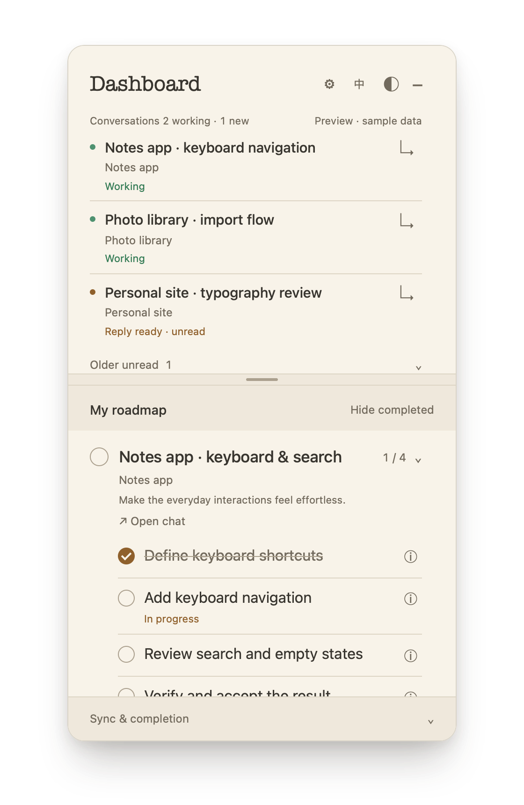
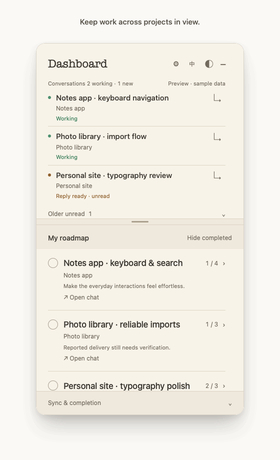
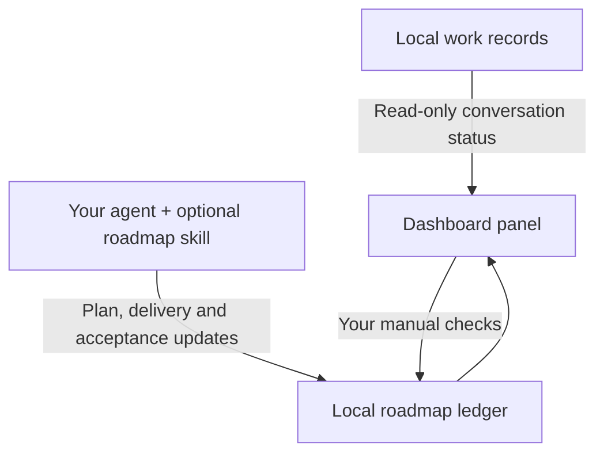

# Dashboard for Codex

An independent macOS companion for local work in ChatGPT Desktop.

**Keep your conversations in view. Give every task a roadmap.**

Follow work across projects, catch new replies, and expand each task into a checklist you can verify step by step.

[简体中文](README.zh-CN.md) · [Get started](#get-started-in-three-steps) · [Setup guide](docs/CONNECT.md) · [Data handling](docs/PRIVACY.md)

<a href="docs/preview-en.png"></a>

## See it in action

<a href="docs/demo-en.gif"></a>

A 14-second sample-data walkthrough of the public interface. Conversation events and an agent's delivery report are simulated; expanding a task and checking a step use the actual preview controls. No real conversation or project is shown. [Demo details](docs/DEMO.md).

## Three things to keep in view

- **Conversations:** distinguish working chats from unread replies, with stable ordering while responses stream and older unread replies folded away.
- **Roadmaps:** expand tasks into steps, see progress and evidence, and jump back to the linked local work chat.
- **Completion:** an agent's delivery report remains pending review until verified or checked by you. Your manual checks and reopened steps take priority.

The panel has independently scrollable sections, a draggable divider, five themes, and English / Simplified Chinese switching.

## Get started in three steps

This release is a **source preview**. Native installation requires macOS 15+, Swift 6 command-line tools and Python 3.9+. A prebuilt, notarized download is not available yet.

1. **Install.** [Download the source preview](https://github.com/TeabagCollector/roadmap-dashboard/releases/latest), extract it, and run `Install.command`. For a no-install look, open `src/index.html` in a browser.
2. **Connect.** Open the native app's gear button and select **Connect local ChatGPT Desktop work records**. Start with a new roadmap, or choose **Share an existing roadmap** if you already have a `ledger.json`.
3. **Track a real task.** In setup, optionally choose **Install roadmap skill**. Start a new supported agent chat and invoke `$roadmap-dashboard-sync` with a concrete task. The agent maintains the plan at meaningful checkpoints; use the panel to inspect progress and check results.

The browser preview uses fictional data and cannot connect real files. The native application and data directory keep their existing Roadmap Dashboard Preview names in this release. See the [full setup and removal guide](docs/CONNECT.md) for dependency checks, manual unread setup, shared roadmaps and troubleshooting.

## How synchronization works



Conversation monitoring reads local records. Roadmap maintenance uses the agent already handling your task and the optional skill; installing the panel alone does not turn every chat into a task. Core monitoring and checklist synchronization make no background model calls.

## Compatibility and release status

Built and tested with **local Codex-backed work/coding conversations in ChatGPT Desktop on macOS**. It does not connect to your ChatGPT account or retrieve general cloud chat history. Switching the interface language does not translate conversation or task text.

This is an independent project, not an official OpenAI product. Other clients, remote hosts and additional agent runtimes have not been verified. Local record formats may change; unrecognized activity is shown as unknown.

The source preview has been tested on one Apple silicon Mac. The locally built app is ad-hoc signed, not notarized. Intel and installation on a second physical machine remain unverified. The screenshots and walkthrough use fictional sample data.

## Development

```sh
bash build.sh
python3 -m unittest discover -s tests -p 'test_*.py'
node --test tests/conversations.test.cjs
```

Source export: `scripts/export_source.py`. See [data handling](docs/PRIVACY.md) and [related tools](docs/LANDSCAPE.md).

## License

[MIT](LICENSE) · Copyright © 2026 TeabagCollector.
