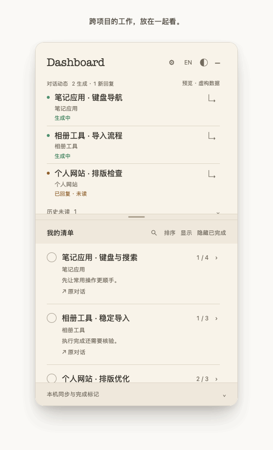
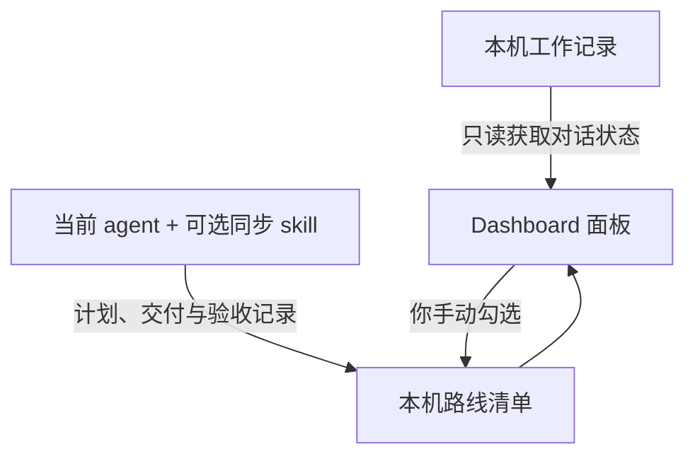

# Dashboard for Codex

An independent macOS companion for local work in ChatGPT Desktop.

**把对话放在眼前，让每个任务都有路线。**

为 macOS 上的 ChatGPT Desktop 本机工作设计的独立伴随面板：跨项目看对话、留意新回复，把任务展开成可以逐步核验的清单。

[English](README.md) · [三步入门](#三步入门) · [完整接入指南](docs/CONNECT.md) · [数据读写](docs/PRIVACY.md)

<a href="docs/preview-zh.png"></a>

## 看它如何工作

<a href="docs/demo-zh.gif"></a>

约 14 秒的公开界面样例演示。对话事件和 agent 交付报告是模拟输入；展开任务和勾选步骤使用预览本身的真实控件。不展示任何真实对话或项目。[演示说明](docs/DEMO.md)。

## 三件事，一眼看清

- **对话：** 区分正在生成与已回复未读，生成期间保持顺序稳定，历史未读默认折叠。
- **路线：** 展开任务查看步骤、进度与证据，返回关联的本机工作对话。
- **完成：** agent 上报交付后仍待核验，验证或由你勾选后才算完成。保留手动完成与重新打开的选择。

对话区和清单区可拖动调整、独立滚动；支持五种主题和中英界面切换。

## 三步入门

**Apple silicon 应用测试预览：** [下载 v0.5.0-preview.1](https://github.com/TeabagCollector/roadmap-dashboard/releases/tag/v0.5.0-preview.1)。自带 Python，无需安装开发工具；**尚未公证**，首次打开可能被 macOS 拦截，第二台真实 Mac 仍待验证。请先阅读[安装与测试说明](docs/INSTALL-MACOS.md)。

如果选择**源码安装**，需要 macOS 15+、Swift 6 命令行工具和 Python 3.9+。

1. **安装。** [下载源码预览](https://github.com/TeabagCollector/roadmap-dashboard/releases/latest)，解压后运行 `Install.command`。只想先看看，可以在浏览器打开 `src/index.html`。
2. **接入。** 在原生面板的齿轮页选择“连接 ChatGPT Desktop 本机工作记录”。初次使用建立新清单；已有 `ledger.json` 可选“使用已有清单”。
3. **追踪工作。** 可在接入页选择安装 `roadmap-dashboard-sync` skill，在新的受支持 agent 对话中用 `$roadmap-dashboard-sync` 发起一个具体任务。agent 在计划、交付等节点维护路线，你在面板查看进度和核验结果。

浏览器预览只使用虚构数据，不能接入真实文件。源码构建的应用和数据目录沿用 Roadmap Dashboard Preview 名称；预编译候选应用名为 Dashboard for Codex。依赖检查、手动未读、共享清单和卸载见[完整指南](docs/CONNECT.md)。

## 同步怎么实现



对话状态来自本机记录；路线由当前处理任务的 agent 配合同步 skill 维护。仅安装面板不会自动把所有聊天变成任务。基础监测和清单同步不额外调用后台模型。

## 支持范围与版本状态

当前开发和验证针对 **ChatGPT Desktop 中基于本地 Codex 记录的工作／编程对话**。不连接 ChatGPT 账号，不获取普通云端聊天历史。中英切换不会翻译对话与任务正文。

这是独立项目，并非 OpenAI 官方产品。其他桌面客户端、远程主机及其他 agent 兼容性尚未验证；上游格式变化时，无法判断的活动会显示为未知。

源码预览已在一台 Apple silicon Mac 验证。本地构建应用采用临时签名，尚未公证；Intel 和第二台真实机器安装仍待验证。截图和演示均使用虚构样例。

## 开发与许可

```sh
bash build.sh
python3 -m unittest discover -s tests -p 'test_*.py'
node --test tests/conversations.test.cjs
```

源码导出：`scripts/export_source.py`。另见[相关工具](docs/LANDSCAPE.md)。

采用 [MIT 许可](LICENSE)，Copyright © 2026 TeabagCollector。
