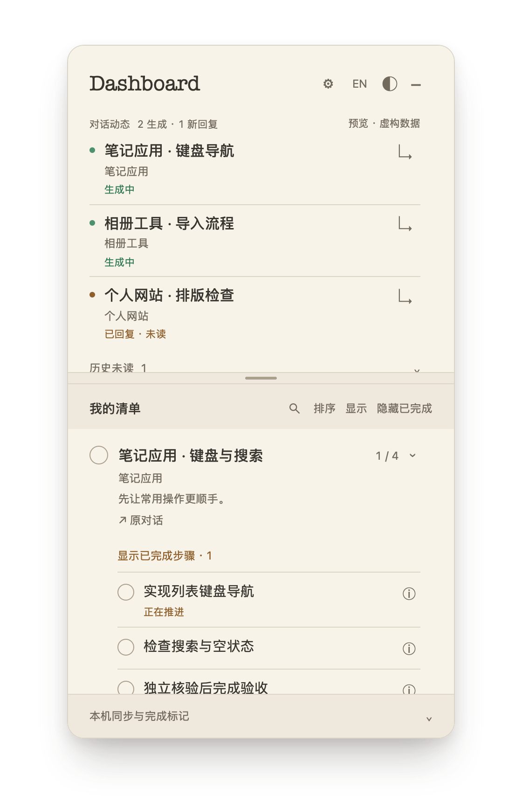

# Roadmap Dashboard

为 **macOS 上的 ChatGPT Desktop** 设计的小型伴随面板，把工作对话和可展开的 roadmap 放在一起。

[English](README.md) · [安装与接入](docs/CONNECT.md) · [数据读写](docs/PRIVACY.md)

<a href="docs/preview-zh.png"></a>

## 功能

- 集中查看进行中的对话和未读回复，减少在项目之间来回切换。
- 展开任务下的 roadmap，用勾选、进度和验收记录跟踪工作。
- 回答生成期间保持顺序稳定，区分正在生成与回复未读。
- 调整对话区和清单区的比例，各自独立滚动。
- 中英界面切换，支持五种颜色主题。
- 区分“已上报”和“已验收”，保留用户手动完成或重新打开的选择。

## 支持范围

当前开发和验证针对 **ChatGPT Desktop 中基于本地 Codex 记录的工作／编程对话**。面板读取本机工作记录，不连接 ChatGPT 账号，也不获取普通云端聊天历史。切换界面语言不会翻译对话和清单正文。

这是一个独立伴随应用。其他桌面客户端、远程主机和其他 agent 的兼容性尚未验证；上游本地格式变化时，会将无法判断的状态显示为未知。

## 使用

打开 `src/index.html` 可体验虚构样例，右上角 **EN / 中** 切换语言。

原生版需要 macOS 15+、Swift 6 命令行工具和 Python 3.9+：

```sh
bash build.sh
"build/Roadmap Dashboard Preview.app/Contents/MacOS/roadmap-dashboard" --language zh
```

也可先运行 `python3 scripts/install.py --dry-run` 检查安装条件，再运行 `Install.command` 安装到自己的 Applications 目录。打开面板齿轮页，接入本机工作对话并选择清单。共享清单、可选同步 skill 和卸载方式见[安装与接入指南](docs/CONNECT.md)。

当前为源码预览，只在一台 Apple silicon Mac 上验证；应用为本地临时签名，尚未公证，Intel 和第二台机器安装仍待验证。监测和清单同步由本机程序执行，不额外调用后台模型；对话中的计划编排由正在处理该对话的模型完成。

## 开发与许可

```sh
python3 -m unittest discover -s tests -p 'test_*.py'
node --test tests/conversations.test.cjs
```

采用 [MIT 许可](LICENSE)，Copyright © 2026 TeabagCollector。
